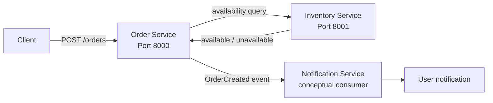
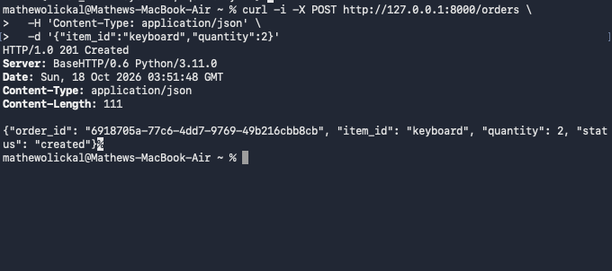
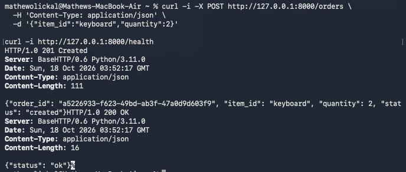
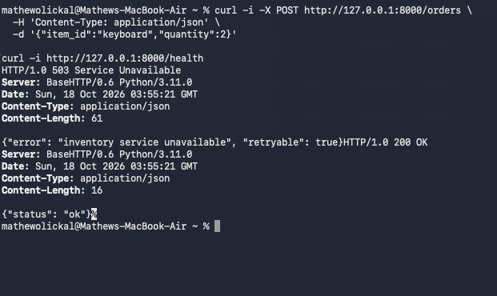

# Online Store: Service Boundaries

This repository demonstrates an online store split into independently running services. It uses Python 3 and the standard library, so there are no external dependencies.

## Architecture



### Responsibilities and data ownership

| Component | Responsibility | Owns |
|---|---|---|
| Order Service | Validates order requests, checks inventory, creates and tracks orders, and returns the result to the client. | Order records and order status. |
| Inventory Service | Answers availability questions for items. | Item availability/stock quantities. |
| Notification Service | Consumes `OrderCreated` events and represents notifying the user. It is shown as a future event consumer because the assignment's executable interaction is Order → Inventory. | Notification delivery state and preferences. |

These boundaries keep each service responsible for one business capability and prevent the Order Service from reading or changing Inventory's data directly. Each service can change or scale independently, and the API/event contracts make communication explicit. The Notification Service receives an event rather than being called as part of order creation, so a notification concern does not become a hard dependency of the order path.

## Setup

This project requires Python 3 and uses only the Python standard library, so no additional dependencies are required.

Verify that Python 3 is installed:

```bash
python3 --version
```

Clone the repository:

```bash
git clone https://github.com/mathewpius19/Architecture_and_Service_Boundaries_CMPE_273.git
cd Architecture_and_Service_Boundaries_CMPE_273
```

## Command, Query, and Event

| Interaction | Classification | Why |
|---|---|---|
| Check whether an item is available | Query | It asks for information and does not change inventory. In this implementation it is `GET /inventory/items/{item_id}?quantity={quantity}`. |
| Create an order | Command | It requests a state change: creating an order. It is `POST /orders`. |
| Order was created | Event | It describes a fact that already happened. The Order Service would publish `OrderCreated` for Notification to consume. |

## Run the services

Open two terminals in this directory:

```bash
python3 inventory_service.py
python3 order_service.py
```

The Inventory Service listens on `127.0.0.1:8001`; the Order Service listens on `127.0.0.1:8000`. To use different ports, set `INVENTORY_PORT`, `ORDER_PORT`, and/or `INVENTORY_URL`.

## Example successful request

With both services running, submit an order for the sample `keyboard` item:

```bash
curl -i -X POST http://127.0.0.1:8000/orders \
  -H 'Content-Type: application/json' \
  -d '{"item_id":"keyboard","quantity":2}'
```

Example response (the UUID is generated at runtime):

```text
HTTP/1.0 201 Created
Content-Type: application/json

{"order_id":"<generated-uuid>","item_id":"keyboard","quantity":2,"status":"created"}
```

Screenshot captured during verification:



The unavailable sample item `mouse` returned `409 Conflict` during the same verification run.

An unavailable item, such as `mouse`, returns `409 Conflict` with `"error":"item unavailable"`.

The second supplied screenshot confirms that the Order Service health endpoint returned `200 OK` during normal operation:



## Failure test: Inventory Service stopped

After stopping the Inventory Service, submit the same request again. The Order Service remains running and handles the dependency failure:

```text
$ curl -i -X POST http://127.0.0.1:8000/orders \
    -H 'Content-Type: application/json' \
    -d '{"item_id":"keyboard","quantity":2}'
HTTP/1.0 503 Service Unavailable
Content-Type: application/json

{"error":"inventory service unavailable","retryable":true}
```

The Order Service catches the connection/timeout error, returns `503`, and continues serving requests instead of crashing.

Screenshot captured after stopping Inventory:



## Reflection

Clear service boundaries make ownership and responsibilities understandable, which reduces accidental coupling between parts of a distributed system. Data ownership ensures that services access information through stable contracts instead of reaching into another service's storage. This makes services easier to change, test, deploy, and scale independently. It also makes failures easier to contain because the Order Service can handle an unavailable Inventory dependency explicitly.
